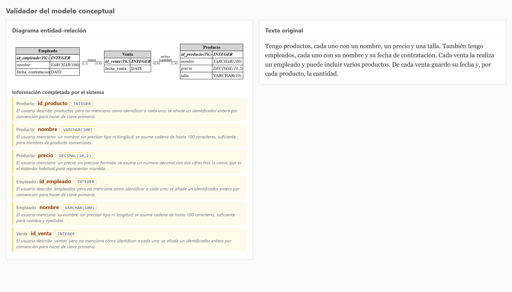
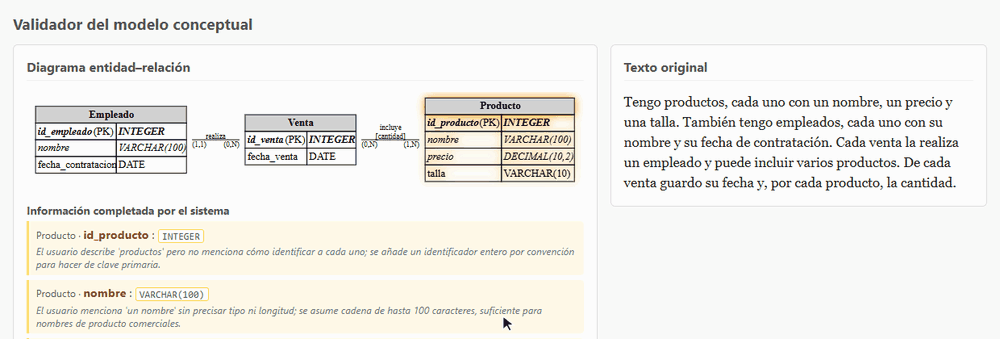
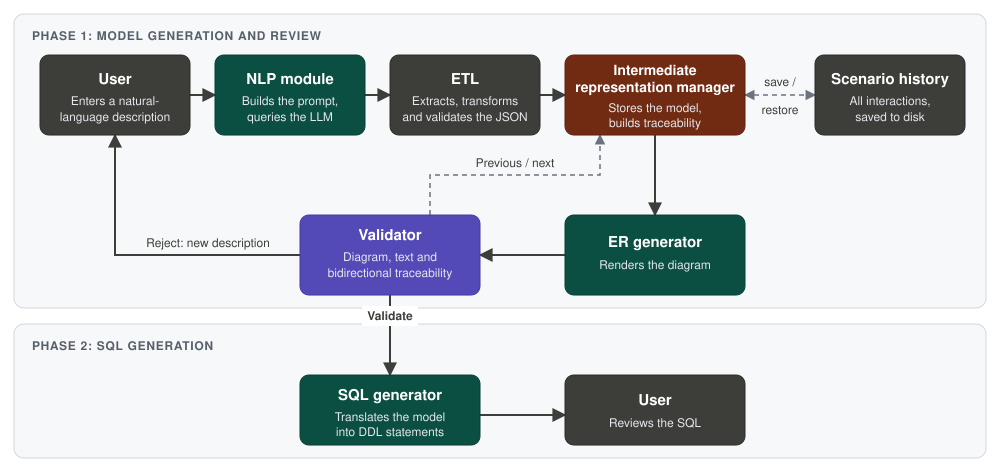

# NL2DB

**Local LLM-powered database design, with human validation before any SQL is generated.**

[](https://www.python.org/)
[](https://flask.palletsprojects.com/)
[](https://graphviz.org/)
[](https://ollama.com/)
[](LICENSE)


NL2DB is an end-to-end Python pipeline that transforms natural-language descriptions into relational database schemas using local Large Language Models (LLMs), ETL processing, an intermediate representation, Entity-Relationship diagrams and SQL generation. Everything runs on your machine through [Ollama](https://ollama.com/).

LLM output is non-deterministic and can be wrong, so NL2DB never sends it straight to SQL. Every response is cleaned and checked by an ETL stage, converted into a model-independent representation, and shown to a person for review. SQL is generated only after that review.

Developed as a Bachelor's Thesis (TFG) at the University of Granada.



*The validator for the bundled `tienda_ropa` example. The interface is in Spanish.*

## Key features

- **Natural language to schema:** extracts entities, attributes, data types, primary keys, relationships, cardinality and participation.
- **Resilient LLM parsing:** the ETL stage handles Markdown fences and surrounding prose, normalizes minor inconsistencies, and rejects invalid responses, including relationships to undefined entities, with a clear error.
- **Explainable inference:** every element the model adds on its own is flagged as inferred and comes with a stated reason.
- **Bidirectional traceability:** hovering over an entity or relationship highlights its source text, and hovering over the text highlights the matching diagram element.
- **Human-in-the-loop validation:** review the model in the browser, then approve it or rewrite the description.
- **Scenario history:** each attempt is saved as an interaction you can step through and reopen later. History is never overwritten.
- **Swappable components:** the NLP backend, ER generator, validator and SQL generator sit behind abstract interfaces.
- **LLM-free mode:** a simulated backend runs the full pipeline on the bundled examples, with no model required.

Traceability in the validator, from the diagram to the text and back:



## How it works



| Component | Location | Responsibility |
|---|---|---|
| NLP | `src/nlp/` | Builds the prompt and returns the raw LLM response |
| ETL | `src/etl/` | Extracts the JSON, normalizes it and enforces the expected structure |
| Intermediate representation | `src/representacion/` | Holds scenarios, interaction history and traceability |
| ER generator | `src/generador_er/` | Renders the model as an SVG with addressable nodes |
| Validator | `src/validador/` | Produces the interactive review page |
| SQL generator | `src/generador_sql/` | Maps the approved model to ANSI SQL DDL |
| Controller | `src/controlador/` | Orchestrates the two workflows: model generation and SQL generation |
| Web interface | `src/comunicacion/` | Exposes the system through a Flask application |

### Relational mapping rules

| Relationship | Result in SQL |
|---|---|
| 1:N | Foreign key on the N side, `NOT NULL` when participation is mandatory |
| 1:1 | Foreign key with `UNIQUE`, placed according to participation |
| N:M | Junction table with a composite primary key and the relationship's own attributes |

## Example

The input language is Spanish. This is the bundled `tienda_ropa` (clothing store) example:

> Tengo productos, cada uno con un nombre, un precio y una talla. También tengo empleados, cada uno con su nombre y su fecha de contratación. Cada venta la realiza un empleado y puede incluir varios productos. De cada venta guardo su fecha y, por cada producto, la cantidad.

*I have products, each with a name, a price and a size. I also have employees, each with their name and hiring date. Each sale is made by one employee and can include several products. For each sale I store its date and, for each product, the quantity.*

Generated DDL:

```sql
CREATE TABLE Producto (
    id_producto INTEGER NOT NULL,
    nombre VARCHAR(100) NOT NULL,
    precio DECIMAL(10,2) NOT NULL,
    talla VARCHAR(10),
    CONSTRAINT pk_Producto PRIMARY KEY (id_producto)
);

CREATE TABLE Empleado (
    id_empleado INTEGER NOT NULL,
    nombre VARCHAR(100) NOT NULL,
    fecha_contratacion DATE,
    CONSTRAINT pk_Empleado PRIMARY KEY (id_empleado)
);

CREATE TABLE Venta (
    id_venta INTEGER NOT NULL,
    fecha_venta DATE NOT NULL,
    realiza_id_empleado INTEGER NOT NULL,
    CONSTRAINT pk_Venta PRIMARY KEY (id_venta),
    CONSTRAINT fk_Venta_realiza FOREIGN KEY (realiza_id_empleado) REFERENCES Empleado(id_empleado)
);

-- Tabla intermedia generada por la relación N:M entre Venta y Producto
CREATE TABLE Venta_Producto (
    id_venta INTEGER NOT NULL,
    id_producto INTEGER NOT NULL,
    cantidad INTEGER NOT NULL,
    CONSTRAINT pk_Venta_Producto PRIMARY KEY (id_venta, id_producto),
    CONSTRAINT fk_Venta_Producto_Venta FOREIGN KEY (id_venta) REFERENCES Venta(id_venta),
    CONSTRAINT fk_Venta_Producto_Producto FOREIGN KEY (id_producto) REFERENCES Producto(id_producto)
);
```

> This output comes from the hand-authored model in `ejemplos/tienda_ropa.json`, which the simulated backend uses. Results from a real LLM run can differ.

## Getting started

### Prerequisites

- Python 3.9+
- The [Graphviz](https://graphviz.org/download/) system binary. The Python package alone is not enough, and diagram generation fails without it.
- [Ollama](https://ollama.com/), only if you want to process your own descriptions

Install Graphviz with your system's package manager:

```bash
sudo apt install graphviz        # Debian/Ubuntu
brew install graphviz            # macOS
winget install Graphviz.Graphviz # Windows (make sure dot is on PATH)
```

### Installation

```bash
git clone https://github.com/ximo204/NL2DB.git
cd NL2DB
python3 -m venv venv
source venv/bin/activate         # Windows: venv\Scripts\activate
pip install -r requirements.txt
```

### Quick start, no LLM required

Simulated mode is the default:

```bash
python -m src.comunicacion.web
```

Open <http://localhost:5001> and paste the example description above. This mode only recognizes the descriptions stored in `ejemplos/`.

### Run with a local LLM

Download the model, then start the application with the Ollama backend. Ollama must be running on `localhost:11434`.

```bash
ollama pull qwen2.5:7b
export NLP_BACKEND=ollama
python -m src.comunicacion.web
```

On Windows PowerShell:

```powershell
ollama pull qwen2.5:7b
$env:NLP_BACKEND = "ollama"
python -m src.comunicacion.web
```

Without a dedicated GPU, one description can take around 10 minutes with this model.

### Configuration

| Environment variable | Default | Description |
|---|---|---|
| `NLP_BACKEND` | `simulado` | `ollama` uses the local LLM, any other value uses the simulated backend |
| `OLLAMA_MODELO` | `qwen2.5:7b` | Any model available in your Ollama installation |

### Other entry points

| Command | Purpose |
|---|---|
| `python app.py [example]` | Runs both workflows in the console and prints the SQL. Skips the interactive review |
| `python mostrar_validador.py [example]` | Generates the validator page for an example without the web server |
| `python main.py` | Runs the SQL and ER generators directly on `tienda_ropa` |
| `python probar_etl.py` | Shows how the ETL handles seven kinds of LLM response, including invalid ones |

`[example]` is `tienda_ropa` (default) or `universidad`. Generated files go to `salidas/` and saved scenarios to `escenarios/`.

## Testing

```bash
pip install -r requirements-dev.txt
pytest
```

The suite covers the ETL, the relational mapping rules, the ER generator, scenario history and the main workflow, with no LLM required. Generated DDL is executed in an in-memory SQLite database to confirm that it is valid and that keys behave as expected. The SVG rendering tests are skipped if Graphviz is not installed.

## Project structure

```text
NL2DB/
├── docs/                     # README images
├── ejemplos/                 # Example models and hand-authored traceability maps
├── src/
│   ├── comunicacion/         # Flask web interface
│   ├── controlador/          # Workflow orchestration
│   ├── etl/                  # LLM response cleaning and validation
│   ├── generador_er/         # ER diagram generation
│   ├── generador_sql/        # SQL DDL generation
│   ├── nlp/                  # LLM backends and prompt
│   ├── representacion/       # Intermediate representation and scenarios
│   └── validador/            # Interactive review page
├── tests/                    # Automated test suite
├── app.py                    # Console pipeline
├── main.py                   # Direct generator run
├── mostrar_validador.py      # Standalone validator generation
├── probar_etl.py             # ETL demonstration
├── requirements.txt
└── requirements-dev.txt      # Adds the test dependencies
```

## Design decisions

- **Intermediate representation over direct LLM output.** Downstream stages depend on a stable contract, not on one model's response format. Changing the model or backend does not affect SQL or diagram generation.
- **Treat LLM output as untrusted input.** The ETL corrects what is safe to correct, such as a nullable primary key, and rejects the rest. A failed response leaves the system state untouched.
- **Validate before generating SQL.** Modelling involves interpretation, so the web workflow keeps generation and SQL as two separate steps with a human decision between them.
- **Make assumptions visible.** Inferred elements are marked and justified, so the reviewer can see what came from the text and what the model assumed.
- **Local-first inference.** Descriptions never leave the machine, and no API key or external service is needed.

## Limitations

NL2DB is an academic prototype, not a production tool.

- The prompt and examples are in Spanish. Other input languages have not been evaluated.
- Schema quality depends on the model and the description, and has not been measured over a benchmark yet.
- Foreign keys assume single-column primary keys.
- Automatic traceability uses lexical matching, so it is less precise than the hand-authored maps in the examples.
- The Flask application holds a single shared session and runs in debug mode, so it is meant for local use only.
- SQL is generated in standard ANSI form and is not executed against a database.

## Roadmap

- [x] Automated tests for the ETL, generators and core workflow
- [ ] Continuous integration through GitHub Actions
- [ ] Evaluation over a larger set of examples, with a comparison across models
- [ ] Additional SQL dialects, such as PostgreSQL and MySQL
- [ ] Additional LLM providers
- [ ] Docker packaging

## Academic context

Developed as a Bachelor's Thesis (TFG) for the **B.Sc. in Computer Engineering at the University of Granada**. The project explores how Large Language Models can be integrated into structured database design pipelines.

## Author

**Javier Gómez Moleón**, Computer Engineer · Junior Data Engineer

[GitHub](https://github.com/ximo204) · [LinkedIn](https://www.linkedin.com/in/jgommol/)

## License

Released under the [MIT License](LICENSE).
